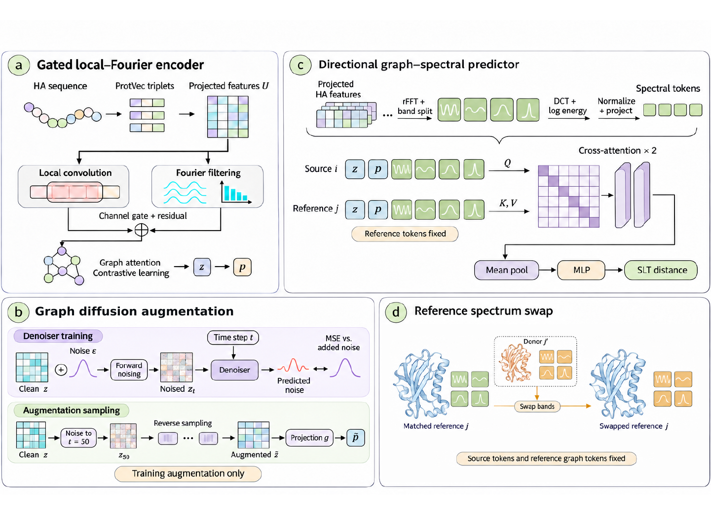

# SpecFuse: Graph–Spectral Cross-Attention Fusion for Ordered Strain-Pair Antigenic Distance Prediction

## Overview

SpecFuse predicts the antigenic distance between an ordered pair of influenza
strains — a source (antiserum strain) and a reference (virus strain) — from
haemagglutination-inhibition (HI) measurements. Each strain is represented by
two graph tokens, taken from a strain-graph encoder, and four spectral tokens,
obtained by a band-wise DCT of the Fourier spectrum of the same features. The
two token types are fused by directional cross-attention, in which source
tokens query reference tokens, so that the source–reference orientation implied
by the SLT target is preserved inside the fusion stage rather than only in the
input format.

## Model Architecture



*Figure 1: SpecFuse pipeline. The gated local–Fourier adapter refines the raw
per-strain features, the strain-graph encoder produces the graph embeddings,
and the directional cross-attention head fuses two graph tokens with four
spectral tokens.*

## Repository contents

```
SpecFuse/
├── graphData.py      strain-graph loader (xlsx + ProtVec)
├── adapter.py        gated local–Fourier adapter
├── spectral.py       spectral token construction + dataset assembly
├── model.py          SpecFuse head and ablation variants
├── train.py          training entry point
├── eval.py           evaluation entry point (deterministic or MC-dropout)
├── plm_baseline.py   protein-language-model baselines
├── model.png         architecture figure
├── data/             raw SLT tables and ProtVec embeddings
├── splits/           fixed inner-train / inner-val / test index sets
├── splits_asym/      pair splits used by the PLM comparison
├── embeddings/       frozen PLM embeddings (5 models x 3 datasets)
├── frozen/           frozen adapter and graph-embedding artefacts
└── MANIFEST.csv / DATA_PROVENANCE.md
```

## Environment

```
Python            3.10.12
PyTorch           2.14.1+cu130
NumPy             2.2.6
pandas            2.x
scikit-learn      1.x
torch-geometric   2.x
CUDA              13.0
GPU               NVIDIA RTX 4090 (24 GB)
```

## Installation

```bash
git clone <repository-url>
cd SpecFuse
pip install -r requirements.txt
```

## Data

`data/` contains the raw measurements used in the paper:

| File | Content |
|---|---|
| `h1n1_566.xlsx` | A/H1N1 SLT table (ordered pairs, HI distances, HA sequences) |
| `h3n2_566_asym.xlsx` | A/H3N2 SLT table |
| `bvic_585_asym.xlsx` | B/Victoria SLT table |
| `protVec_100d_3grams.csv` | 100-d ProtVec trigram embeddings |

`graphData.py` builds the strain graph from these files; no network access is
required at run time.

`splits/` fixes the three index sets (`inner_train`, `inner_val`, `test`) for
each dataset and seed. The reported numbers depend on these exact splits, so
they are shipped rather than regenerated.

`frozen/` holds the artefacts of the upstream encoder, which is trained once
and then held fixed: `adapter_ckpt.pt` (gated local–Fourier adapter),
`z1.pt` (graph-encoder embeddings) and `proj_z1.pt` (projected embeddings).
They are shipped because retraining the encoder is both expensive and not
bit-reproducible.

## Usage

Train the full head on one dataset and seed:

```bash
python train.py --dataset h1n1_566 --seed 42
```

Trained heads are written to `runs/<variant>_bl<blocks>_w<width>/<dataset>/s<seed>/`
together with `result.json` and `history.json`.

Evaluate a trained head on the held-out split:

```bash
python eval.py --run runs/full_bl2_w256/h1n1_566/s42           # deterministic
python eval.py --run runs/full_bl2_w256/h1n1_566/s42 --mc 100  # MC-dropout
```

## Protein-language-model baselines

`plm_baseline.py` reproduces the PLM comparison (Table 4). Each pretrained model
contributes one frozen embedding per strain; a pair is represented as
`[e_src, e_ref, |e_src - e_ref|]` and mapped to a distance by a two-layer MLP
(512 / 256 hidden units, dropout 0.2, 300 epochs, batch 1024, AdamW lr 1e-3
wd 1e-5, checkpoint selected on inner-validation MAE).

```bash
python plm_baseline.py --dataset h1n1_566 --seed 42 --model ProtT5
```

The embeddings live in `embeddings/plm_strains/` as float16 archives
(`h1n1_566__ProtT5.npz`, `...__BioGPT.npz`, `...__ESM2.npz`,
`...__ProGen2.npz`, `...__ProtBERT.npz`, likewise for the other two datasets),
with a `.names.txt` row index per dataset. The pair splits used here are in
`splits_asym/` and follow the same construction as the SpecFuse splits.

Verified: ProtT5 on `h1n1_566`, seed 42 gives test MAE 0.5728 with 1,704,961
parameters, against 0.5741 (three-seed mean) in the paper.

Note that the PLM comparison and the main results are computed on different
variants of the H1N1 table (see `DATA_PROVENANCE.md`); aligning them to a single
variant is left for a future revision.
## Reproducing the reported results

Default configuration (Section 4.4): four spectral bands, eight DCT
coefficients, width 128, four attention heads, FFN 256, dropout 0.4, two
blocks, AdamW with lr 1e-3 and weight decay 1e-5, batch 512, 1200 epochs.
The head is selected on inner-validation MAE.

| Configuration | Command | Params | Macro-avg test MAE |
|---|---|---|---|
| Full SpecFuse | `python train.py --dataset <ds> --seed <s>` | 309,633 | 0.6209 |
| Concatenation + MLP (matched) | `--variant noattn --width 171` | 310,252 | 0.6407 |
| Graph-only (matched) | `--variant noattn_graph --width 474` | 309,467 | 0.6576 |
| Spectral-only (matched) | `--variant noattn_spec --width 251` | 309,820 | 0.6456 |
| Graph-only (small) | `--variant graph --blocks 1` | 176,641 | 0.6532 |
| Spectral-only (small) | `--variant spec --blocks 1` | 177,153 | 0.6362 |

`<ds>` is one of `h1n1_566`, `h3n2_566_asym`, `bvic_585_asym`; `<s>` is one
of `42`, `123`, `2024`. The three-dataset macro average is the mean of the
per-dataset means over the three seeds.

Verified reproduction on an RTX 4090 (full head, `h1n1_566`, seed 42, 1200
epochs, ~17 min): 309,633 parameters, best epoch 819, MC-100 test MAE 0.5519
against the published 0.5523. The spectral cache rebuilt from `data/` +
`frozen/` is bit-identical to the cache used for the paper.

Test MAE in the paper is computed from the mean of 100 test-time dropout
predictions per record (`--mc 100`). Deterministic evaluation gives slightly
different values; both are produced by `eval.py`.

## Data availability

All tables, splits, frozen artefacts and PLM embeddings needed to reproduce the
reported numbers are included in this repository (see `MANIFEST.csv` for a
checksummed file list).

The SLT tables and the ProtVec table are third-party material: they were
released with the DiffAD study and derive from WHO/CDC surveillance data. **No
license is declared for the data repository they come from**, so redistribution
must be confirmed with the data authors before this package is made public.
`DATA_PROVENANCE.md` records the exact provenance and the redistribution
caveat; `scripts/fetch_data.py` is the fallback route if the tables cannot be
shipped.

## Scope and limitations

- Only the prediction head is trained here. The adapter and graph encoder are
  frozen and shipped in `frozen/`.
- Implementations of published baselines (DiffAD and others) are not included;
  the comparisons in the paper use values reported in the original
  publications under their own protocols.
- The three SLT tables are redistributed for reproducibility of this study.
  Please cite the original benchmark sources when reusing them.

## Citation

```bibtex
@article{specfuse,
  title   = {SpecFuse: Graph-Spectral Cross-Attention Fusion Framework with
             Directional Role Preservation for Ordered Strain-Pair Antigenic
             Distance Prediction},
  author  = {<authors>},
  journal = {<journal>},
  year    = {<year>}
}
```

## License

Code released under the MIT License (see `LICENSE`). The data files in `data/`
are redistributed from the original SLT benchmark releases and remain subject to
their own terms.